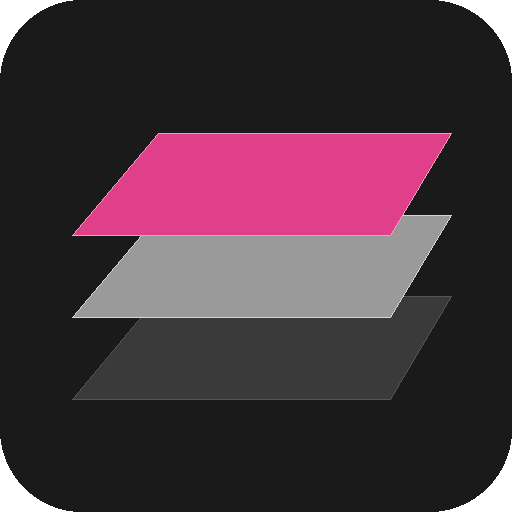
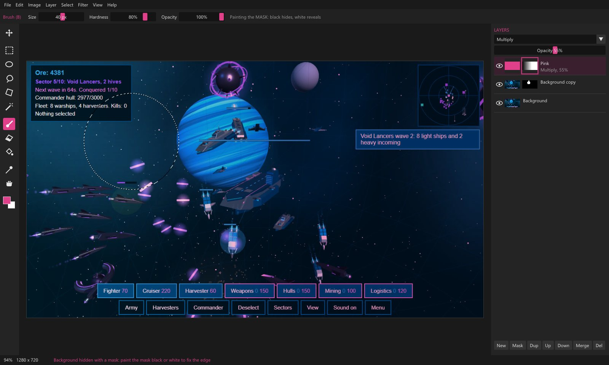

 

  

 

  
  
  

  
  
  

 

  

# LayerTack

**A layer-based image editor for Windows (and Linux), written in C++.** Layers, true layer masks, Photoshop's blend
modes, selections with Select Subject, tonal adjustments and filters, in a dark studio workspace.
**[Website](https://cursedprograms.github.io/LayerTack/)**

## Features

### 1. Layer architecture and masking
- **Layer stack management:** unlimited raster layers; create, delete, duplicate, rename, reorder, show and hide;
  opacity from 0 to 100%. Each layer keeps its own size and position, so moving one never crops it.
- **Non-destructive layer masks:** a mask channel on any layer: black hides, white reveals, greys give partial
  transparency. Add one that reveals all, hides all, or follows the selection; paint it with the brush; fill, blur
  (feather), curve or level it like any picture; invert it, switch it off (Shift-click), view it on its own
  (Alt-click), turn it into a selection, apply it or delete it. While a mask is the target the colours turn black
  and white, and your own come back when you go back to the pixels.
- **Adjustment layers:** Photoshop's 15 adjustments as layers that change everything below them and stay editable:
  Brightness/Contrast, Levels, Curves, Exposure, Vibrance, Hue/Saturation, Color Balance, Black & White, Photo
  Filter, Channel Mixer, Invert, Posterize, Threshold, Gradient Map and Selective Color. Their settings are in the
  Properties panel above the layers; each has its own mask, opacity and blend mode, they're saved in `.ltk`
  projects, and Merge Down bakes one into the layer below (Layer > New Adjustment Layer, or **Adj** under the
  layers).
- **Blend modes:** all 27 of Photoshop's layer modes, with its exact maths: Normal, Dissolve, Darken, Multiply,
  Color Burn, Linear Burn, Darker Color, Lighten, Screen, Color Dodge, Linear Dodge (Add), Lighter Color, Overlay,
  Soft Light, Hard Light, Vivid Light, Linear Light, Pin Light, Hard Mix, Difference, Exclusion, Subtract, Divide,
  Hue, Saturation, Color and Luminosity.
- **Merge operations:** Merge Down, Merge Visible and Flatten Image, baking masks and blend modes into one raster.

### 2. Selection and segment detection
- **Manual selection tools:** Rectangular and Elliptical Marquee, freehand Lasso, Polygonal Lasso and Magic Wand
  (tolerance, contiguous, sample all layers), each in New, Add (Shift), Subtract (Alt) or Intersect mode, with
  anti-aliased edges, feathering and marching ants.
- **Select Subject:** automatic subject detection (U²-Net, run locally through ONNX Runtime) turned into a
  selection.
- **Remove Background:** the same detection as a layer mask in one click, so the edge can still be refined with
  the brush.
- **Select and Mask** (Alt+Ctrl+R): edges that follow the picture, for hair and fur. Radius and Smart Radius
  let the picture decide the edge, then Smooth, Feather, Contrast and Shift Edge; Decontaminate Colors takes the old
  background's colour out of the soft edge. View it Overlay, On Black, On White, Black & White or On Layers, and
  send it to the selection, the layer mask, or a new layer (cut out or masked). It starts from the selection or the
  layer's mask, so Select Subject then Select and Mask cuts out a person, hair and all.
- **Refine:** Inverse, Feather, Grow / Shrink, and Load Selection from a mask or the layer's transparency.

### 3. Canvas tools and painting
- **Brush and Eraser:** size, **hardness** (from a soft airbrush falloff to a crisp edge) and opacity; one stroke
  never builds up past its opacity. On a mask, the brush paints greys.
- **Paint Bucket / flood fill:** tolerance, contiguous or global, sample one layer or all, opacity; it respects the
  selection, so filling a new empty layer and setting its blend mode is quick.
- **Empty-layer workflow:** a new transparent layer in one click (Ctrl+Shift+N), ready for fills, overlays and
  strokes.
- **Transform:** move with the Move tool (arrow keys nudge), Free Transform (Ctrl+T) to scale and rotate a layer and
  its mask round its centre, and flip horizontally or vertically.
- **Eyedropper and Hand:** pick colours from the canvas; pan with the Hand, Space or the middle button; zoom with
  the wheel.

### 4. Tonal, colour and adjustment engine
- **Curves:** a multi-point tone curve for RGB or each channel, over the target's histogram, with smooth monotone
  interpolation (no overshoot).
- **Levels:** input black and white points, gamma, output range.
- **Colour and tone controls:** Brightness/Contrast and Hue/Saturation with Lightness, **Vibrance** and Colorize.
- **Black & White:** Photoshop's converter with six colour sliders (reds, yellows, greens, cyans, blues, magentas)
  and an optional tint.
- **Also:** Invert, Desaturate and Threshold. Every adjustment previews live and works inside the selection.

### 5. Filters and processing effects
- **Gaussian Blur:** a precise radius blur for smooth gradients and depth of field (computed in premultiplied
  alpha, so transparent edges don't pick up dark fringes).
- **Average:** the whole selection becomes its average colour, as in Photoshop; plus **Box Blur** for quick
  uniform smoothing.
- **Add Noise:** Photoshop-style Gaussian or Uniform noise, monochromatic or per channel.

### 6. Changeling filters (Filter > Changeling)
The Changelings work on a photo inside LayerTack: **Imago** (another face), **Tiresias** (the other gender),
**Chronos** (younger or older), **Natio** (born somewhere else), **Cosmeta** (makeup and hair colour) and
**Tonsor** (a hairstyle from a photo).
- **Non-destructive:** the result comes in as a new layer above the picture, in the same place, so masks, opacity
  and blend modes work on it. With a selection, the new layer is masked to it.
- **On the whole picture or one layer:** transparency is kept.
- **In the background:** the log shows progress, and **Stop** ends the run.
- **Needs [Changeling Studio](https://github.com/CursedPrograms/Changeling-Studio)** on the same PC, with the
  Changelings you want set up. LayerTack finds it next to itself, in the usual places or through
  `CHANGELING_STUDIO`; otherwise use **Filter > Changeling > Find Changeling Studio...** The steps and their
  options come from Studio's `chain.py --steps --json`, so new Changelings show up without updating LayerTack.

### Depth maps (Filter > Bathos)
**Filter > Bathos > Depth Map** puts the depth of the picture (or a layer) in as a new layer: near is bright, far is
dark, and faces get a real 3D shape. Detail, edge refine, face relief, colour ramp, far-is-bright and contrast are
in the dialog; with a selection the new layer is masked to it. It runs
**[Bathos](https://github.com/CursedPrograms/Bathos)** (Atelier's depth app) in the background: LayerTack finds
`bathos-cli` next to itself, in its `plugins\Bathos` folder, where Bathos is installed, or in a Bathos folder nearby;
otherwise use **Filter > Bathos > Find Bathos...**

### Face swap (Filter > Mimic)
**Filter > Mimic** swaps a face from a photo onto the picture (or a layer) and puts the result in as a new layer,
masked to the selection when there is one. It runs **[Mimic](https://github.com/CursedPrograms/Mimic)** (Atelier's
face swapper) in the background: LayerTack finds `mimic-cli` next to itself, in its `plugins\Mimic` folder, where
Mimic is installed, or in a Mimic folder nearby; otherwise use **Filter > Mimic > Find Mimic...**

### 7. Export and canvas utilities
- **PNG:** 32-bit PNG with full transparency; JPG export (onto white).
- **Projects:** `.ltk` files keep every layer, mask, blend mode and opacity.
- **Image Size:** bicubic resampling of every layer and mask, with locked proportions.
- **Canvas Size:** grow or crop the canvas round any of nine anchors.
- **Open:** PNG, JPG, BMP, TGA, GIF and flat PSD; drop files on the window to place them as layers.
- **Undo / redo:** the last 20 steps.

### 8. Workspace
The usual layout: menus, a contextual tool options bar, the tools down the left, the canvas in the middle, the
Layers panel on the right and a status bar, in the Cursed dark theme (solid greys with the Cursed pink). The usual
shortcuts: V M L W B E G I H, [ and ] for brush size (Shift for hardness), X swaps colours, D resets them, Ctrl+Z,
Ctrl+J, Ctrl+E, Ctrl+T, Ctrl+M, Ctrl+L, Ctrl+U, Ctrl+I, Ctrl+A, Ctrl+D, Ctrl+Shift+I, Ctrl+0, Ctrl+1.

## Download and run

Windows: build it once (below), then run `cpp/build/Release/LayerTack.exe`, or unzip `cpp/dist/LayerTack-win64.zip`
anywhere and run `LayerTack.exe`. Open a picture with File > Open, by dropping it on the window, or with
`LayerTack.exe picture.png`.

Select Subject downloads its model once (U²-Net-p, about 5 MB) the first time you use it: into
`F:\AIModels\segment` when that drive exists, otherwise into LayerTack's settings folder.

## Build

Windows: Visual Studio 2022 (C++) and CMake, then `cpp/build.bat` (or `build.ps1`). It fetches SDL2 and ONNX
Runtime into `cpp/external/` once, builds `cpp/build/Release/LayerTack.exe` and packs `cpp/dist/LayerTack-win64.zip`.
The zip carries Microsoft's Visual C++ runtime, so LayerTack starts on PCs without it installed. If LayerTack is
installed in `%LOCALAPPDATA%\Programs\LayerTack`, the build updates that copy too (close LayerTack first).

Linux: `cpp/build.sh` (needs cmake, a C++17 compiler and libsdl2-dev; for Select Subject, libonnxruntime.so where
the loader finds it, and zenity for file dialogs).

The code, in `cpp/src/`:
- `doc.cpp`: the document: layers, masks, compositing, files (PNG, JPG, `.ltk`), undo
- `blend.cpp`: the blend modes
- `ops.cpp`: adjustments, filters, fills, selections, resizing, transform and the brush
- `segment.cpp`: Select Subject through ONNX Runtime's C API (loaded at run time)
- `changeling.cpp`: Filter > Changeling: finds Changeling Studio and runs its `chain.py` in the background
- `adjust.cpp`: adjustment layers: the 15 adjustments' maths
- `refine.cpp`: Select and Mask: guided-filter edges, smooth, feather, contrast, shift edge, decontaminate
- `mimicplug.cpp`: Filter > Mimic: finds [Mimic](https://github.com/CursedPrograms/Mimic) (`mimic-cli`) and runs it for a face-swap layer
- `atelier.cpp`: finds the other Atelier apps LayerTack uses as plugins
- `bathos.cpp`: Filter > Bathos: finds [Bathos](https://github.com/CursedPrograms/Bathos) (`bathos-cli`) and runs it for a depth-map layer
- `app.cpp`: the window: menus, tools, canvas, Layers panel and dialogs
- `splash.cpp`: the splash shown while LayerTack loads, and in Help > About
- `main.cpp`: SDL2, OpenGL and Dear ImGui

## Credits

The blend modes, the adjustment layers and Select and Mask are ported from
[PhotoCraft](https://github.com/storytold/photocraft) (MIT OR Apache-2.0); Select and Mask's soft edges are He, Sun
and Tang's guided filter.
Built with [Dear ImGui](https://github.com/ocornut/imgui), [SDL2](https://www.libsdl.org),
[stb](https://github.com/nothings/stb) and [ONNX Runtime](https://github.com/microsoft/onnxruntime); Select Subject
uses [U²-Net](https://github.com/xuebinqin/U-2-Net). See [NOTICE](NOTICE).

 

© Cursed Entertainment 2026

 

